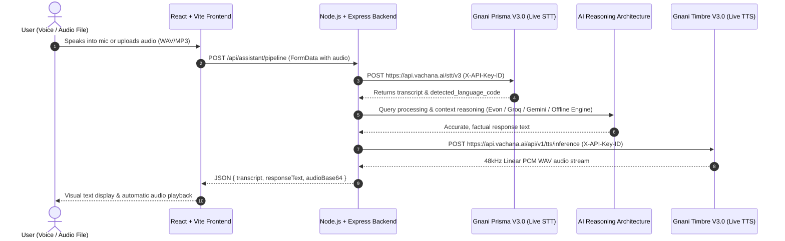

# VoiceBridge AI - Indian Multilingual AI Voice Assistant

[](https://nodejs.org/)
[](https://reactjs.org/)
[](https://vitejs.dev/)
[](https://tailwindcss.com/)
[](https://gnani.ai/)

**VoiceBridge AI** is an enterprise-grade sovereign voice assistant tailored for India's diverse linguistic landscape. It enables users to speak naturally in native Indian languages, transcribes voice queries with live **Gnani Prisma V3.0**, processes queries via intelligent reasoning architecture (supporting Gnani Evon, Groq, Gemini, OpenAI, or the VoiceBridge Knowledge Engine in offline mode), and responds in fluid, expressive neural speech using live **Gnani Timbre V3.0**.

---

## 🌟 Architecture & End-to-End Workflow



---

## 🚀 Key Features

1. **Sovereign Indian Language Stack**: Full native support for **10 Indian languages** including Hindi, Tamil, Telugu, Kannada, Bengali, Marathi, Gujarati, Punjabi, Malayalam, and Indian English.
2. **Gnani Prisma V3.0 (Speech-to-Text - Live Integration)**:
   - Official base endpoint: `https://api.vachana.ai/stt/v3`
   - Unified multilingual recognition with `indic-auto` automatic language detection.
   - Robust code-mixing support (Hinglish, Tanglish).
   - Inverse Text Normalization (ITN) for currencies, numbers, and dates.
3. **AI Reasoning Architecture**:
   - Multi-provider cascade with accurate model attribution.
   - Supports self-hosted **Gnani Evon** (`gnani/gnani-evon-v3.3-30B-A3B`) via vLLM or Hugging Face.
   - Supports high-speed cloud providers: **Groq** (`llama-3.3-70b-versatile`), **Google Gemini** (`gemini-1.5-flash`), **OpenAI** (`gpt-4o-mini`), **Anthropic**, and **Ollama**.
   - Built-in **VoiceBridge Knowledge Engine (Offline Mode)**: Provides accurate, constraint-respecting answers (e.g. "in three sentences") when no external LLM keys are configured, without generic templates or false model attribution.
4. **Gnani Timbre V3.0 (Text-to-Speech - Live Integration)**:
   - Official base endpoint: `https://api.vachana.ai/api/v1/tts/inference`
   - High-fidelity 48,000 Hz Linear PCM WAV synthesis.
   - Expressive neural voices (**Shivani**, **Avinash**, **Nalini**, **Deepak**, **Kaveri**).
   - Dynamic playback rate control (0.8x to 1.5x) and inline audio tag support.
5. **Interactive Audio Suite**:
   - In-browser clean 16-bit PCM WAV recorder via Web Audio API.
   - Drag-and-drop file upload supporting WAV, MP3, OGG, M4A, and FLAC (up to 25MB) with 1-click pre-recorded Indian sample testing.
   - Real-time animated canvas waveform visualizer reacting to live microphone frequencies.
   - Interactive chat timeline with instant replay, seeking, audio downloading, and message copying.
6. **Enterprise Security**:
   - API keys are securely encapsulated in backend environment variables (`X-API-Key-ID`).
   - Zero API keys are ever leaked or exposed to frontend code.

---

## 📁 Project Structure

```
VoiceBridgeAI/
├── backend/
│   ├── .env.example              # Template for backend secrets & endpoints
│   ├── .env                      # Active local environment variables
│   ├── package.json              # Express, Multer, Axios, Cors dependencies
│   └── src/
│       ├── config/
│       │   └── config.js         # Environment & Gnani configuration
│       ├── controllers/
│       │   ├── assistantController.js # End-to-end voice pipeline & config info
│       │   ├── sttController.js       # Gnani Prisma V3.0 STT controller
│       │   ├── ttsController.js       # Gnani Timbre V3.0 TTS controller
│       │   └── chatController.js      # Gnani Evon reasoning controller
│       ├── middleware/
│       │   ├── uploadMiddleware.js    # Multer audio memory storage & filter
│       │   └── errorHandler.js        # Centralized HTTP error handler
│       ├── routes/
│       │   └── api.js                 # API route registrations
│       ├── services/
│       │   ├── gnaniPrismaService.js  # Prisma V3.0 STT API connector
│       │   ├── gnaniTimbreService.js  # Timbre V3.0 TTS API connector
│       │   └── gnaniEvonService.js    # Evon MoE / LLM reasoning connector
│       └── server.js                  # Express server entry point
│
├── frontend/
│   ├── .env.example              # Frontend environment template
│   ├── package.json              # React 18, Vite 6, Tailwind CSS, Lucide icons
│   ├── vite.config.js            # Vite config with backend proxy on /api
│   ├── tailwind.config.js        # Custom palette (#F6F8FC, #2563EB, #14B8A6)
│   ├── postcss.config.js
│   ├── index.html
│   └── src/
│       ├── components/
│       │   ├── Navbar.jsx               # Header with branding & language selector
│       │   ├── HeroSection.jsx          # AI SaaS landing hero banner
│       │   ├── VoiceBridgeDashboard.jsx # Dual-column assistant dashboard
│       │   ├── AudioRecorder.jsx        # Animated mic & PCM WAV recorder
│       │   ├── AudioUploader.jsx        # Drag-and-drop audio file uploader
│       │   ├── WaveformVisualizer.jsx   # Live frequency canvas visualizer
│       │   ├── ChatInterface.jsx        # Dialogue timeline with text input
│       │   ├── MessageBubble.jsx        # Styled user & AI message cards
│       │   ├── AudioPlayer.jsx          # Scrubber, speed & download controls
│       │   ├── ModelSettingsModal.jsx   # Model parameters & API status modal
│       │   └── FeaturesOverview.jsx     # Technology & Indic linguistic matrix
│       ├── services/
│       │   └── apiService.js            # Axios client for backend endpoints
│       ├── utils/
│       │   └── wavRecorder.js           # In-browser PCM 16-bit WAV encoder
│       ├── App.jsx
│       ├── main.jsx
│       └── index.css
│
└── README.md
```

---

## 🛠️ Installation & Setup Guide

### 1. Prerequisites
- **Node.js**: v18.0.0 or higher (v20+ recommended)
- **npm**: v9.0.0 or higher

### 2. Clone or Navigate to the Workspace
```bash
cd VoiceBridgeAI
```

### 3. Backend Setup
1. Open a terminal and enter the backend folder:
   ```bash
   cd backend
   npm install
   ```
2. Configure your environment variables in `backend/.env`:
   ```bash
   cp .env.example .env
   ```
3. Open `backend/.env` and add your **Gnani API Key**:
   ```env
   PORT=5000
   GNANI_API_KEY=your_actual_gnani_api_key_here
   GNANI_BASE_URL=https://api.vachana.ai
   GNANI_PRISMA_MODEL=prisma-v3.0
   GNANI_DEFAULT_LANGUAGE=indic-auto
   GNANI_TIMBRE_MODEL=timbre-v3.0
   GNANI_TIMBRE_VOICE=Shivani

   # Optional: Hosted Evon or Hugging Face token
   EVON_API_BASE_URL=
   HF_API_TOKEN=
   ```
   *(Note: If `GNANI_API_KEY` is omitted, the application runs in a high-fidelity simulation mode for immediate interactive UI previewing).*

4. Start the backend development server:
   ```bash
   npm run dev
   # Server runs at http://localhost:5000
   ```

### 4. Frontend Setup
1. Open a second terminal window and enter the frontend folder:
   ```bash
   cd frontend
   npm install
   ```
2. Start the Vite development server:
   ```bash
   npm run dev
   # App runs at http://localhost:5173
   ```
3. Open `http://localhost:5173` in your browser.

---

## 📡 Official Gnani API Specifications

### 1. Speech-to-Text: Gnani Prisma V3.0
- **Official Base URL**: `https://api.vachana.ai`
- **Method**: `POST /stt/v3`
- **Authentication**: `X-API-Key-ID: <GNANI_API_KEY>`
- **Request Format**: `multipart/form-data`
  - `audio_file`: Binary audio file (`WAV`, `MP3`, `OGG`, `M4A`, `FLAC`)
  - `model`: `prisma-v3.0`
  - `language_code`: `indic-auto` (or `hi-IN`, `ta-IN`, `te-IN`, `en-IN`, etc.)
  - `format`: `transcribe`

**Sample cURL Test**:
```bash
curl -X POST https://api.vachana.ai/stt/v3 \
  -H "X-API-Key-ID: YOUR_API_KEY" \
  -F "audio_file=@sample.wav" \
  -F "model=prisma-v3.0" \
  -F "language_code=indic-auto"
```

### 2. Text-to-Speech: Gnani Timbre V3.0
- **Official Base URL**: `https://api.vachana.ai`
- **Method**: `POST /api/v1/tts/inference`
- **Authentication**: `X-API-Key-ID: <GNANI_API_KEY>`
- **Headers**: `Content-Type: application/json`
- **Request Payload**:
  ```json
  {
    "text": "नमस्ते, वॉयसब्रिज एआई में आपका स्वागत है।",
    "voice": "Shivani",
    "model": "timbre-v3.0",
    "language": "hi-IN",
    "speed": 1.0,
    "audio_config": {
      "sample_rate": 48000,
      "num_channels": 1,
      "sample_width": 2,
      "encoding": "linear_pcm",
      "container": "wav"
    }
  }
  ```
- **Response**: Binary Linear PCM WAV audio (`Content-Type: audio/wav`).

### 3. Reasoning Model: Gnani Evon
- **Hugging Face Model**: [`gnani/gnani-evon-v3.3-30B-A3B`](https://huggingface.co/gnani/gnani-evon-v3.3-30B-A3B)
- **Local vLLM Hosting**:
  ```bash
  vllm serve "gnani/gnani-evon-v3.3-30B-A3B" --port 8000
  ```
  Configure `EVON_API_BASE_URL=http://localhost:8000/v1` in `backend/.env`.

---

## 🧪 Verification & Testing

1. **Verify Backend Status**:
   ```bash
   curl http://localhost:5000/api/assistant/config
   ```
2. **Test Speech Synthesis**:
   ```bash
   curl -X POST http://localhost:5000/api/tts/synthesize \
     -H "Content-Type: application/json" \
     -d '{"text": "नमस्ते!", "voice": "Shivani", "language": "hi-IN"}'
   ```
3. **Test Conversational Reasoning**:
   ```bash
   curl -X POST http://localhost:5000/api/chat/respond \
     -H "Content-Type: application/json" \
     -d '{"message": "What is VoiceBridge AI?", "language": "hi-IN"}'
   ```

---

## 🎨 Design System

- **Background**: `#F6F8FC`
- **Primary Accent**: `#2563EB` (Tailwind Blue 600)
- **Secondary Accent**: `#14B8A6` (Tailwind Teal 500)
- **Typography**: *Plus Jakarta Sans* & *JetBrains Mono*
- **Aesthetic**: Premium Light AI SaaS interface with soft card shadows, pulsing microphone animations, and dynamic audio waveforms.

---

## 📄 License
VoiceBridge AI is open-sourced under the MIT License.

